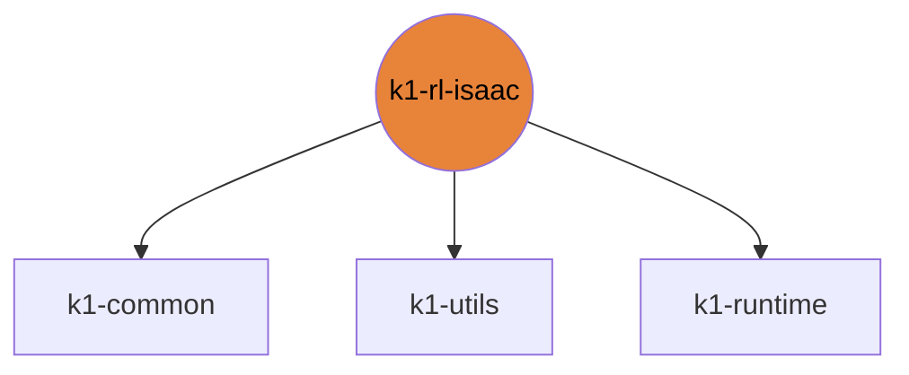

# k1-rl-isaac

Isaac Lab tasks (velocity, push, kick, COMPASS) and Isaac sim nodes.

| | |
|---|---|
| Layer | **L2**: Domain (no cross-imports) |
| May import | [k1-common](https://github.com/thdhyan/k1-common), [k1-utils](https://github.com/thdhyan/k1-utils), [k1-runtime](https://github.com/thdhyan/k1-runtime) |
| Files / LOC | 213 files · 30,838 lines (py, sh, cpp) |
| Part of | [k1-workspace](https://github.com/thdhyan/k1-workspace) (architecture and layering rules live there) |

## Where it sits



Used by: nothing (top layer).


## Install

```bash
uv add git+https://github.com/thdhyan/k1-rl-isaac
# or, from a checkout
uv sync
```

## Layout

```
README.md
docs/  (3 files)
  legacy_README.md
  legacy_pyproject.toml
  legacy_setup.cfg
jobs/  (45 files)
  README.md
  dl_ab_push_home_host.sh
  dl_eval_push_host.sh
  dl_partial800_record_host.sh
  dl_partial800_walk_record_host.sh
  dl_push_base_resume_container.sh
  eval_push.sh
  export_base_policy.sh
  kb_lab_local.sh
  p3_recover_container.sh
  panel_smoke_container.sh
  play_partial_diag.sh
  probe_rewards_container.sh
  push_preflight.sh
  queue_student.sh
  record_p2_final_container.sh
  record_p2_one_container.sh
  record_policies_container.sh
  record_push.sh
  reward_probe.sh
  sim2sim_mjlab_isaac.sh
  smoke_isaac_tasks.sh
  smoke_p3_head.sh
  smoke_p4_teacher.sh
  smoke_push.sh
  spark_force_container.sh
  spark_full_container.sh
  spark_p2_dispcheck_container.sh
  spark_p2_gait_container.sh
  spark_p2_gaitfix_preflight_container.sh
  spark_p2_gaitfix_train_container.sh
  spark_p2_render_container.sh
  spark_p2_velcurriculum_container.sh
  spark_p2_velresume_container.sh
  spark_partial_container.sh
  spark_probe4.sh
  spark_probe5.sh
  spark_probe6.sh
  spark_push_base_container.sh
  spark_push_container.sh
  spark_s1_container.sh
  spark_s2_container.sh
  spark_soccer_container.sh
  sweep_standing_container.sh
  zzbw_push_host.sh
pyproject.toml
ros/  (12 files)
  k1_sim_isaac/  (12 files)
scripts/  (34 files)
  README.md
  eval_push_check.py
  flatten_k1_usd.py
  gait_gate.py
  keyboard_cmd.py
  make_zero_actor.py
  panel_video.py
  plateau_stop.py
  play.py
  play_contact_visualize.py
  play_keyboard.py
  play_keyboard_fixed.py
  play_keyboard_teacher.py
  play_mjlab_policy.py
  play_push_ik.py
  play_record.py
  play_student.py
  ppo_guard.py
  probe_arm_ik.py
  probe_k1_bodies.py
  probe_lowerbody_yaw.py
  probe_rewards.py
  probe_scene_resolver.py
  replay_kick_rtx.py
  reward_probe_check.py
  smoke_task.py
  sweep_standing_gains.py
  task_docs.py
  train.py
  train_kick.py
  train_kick_student.py
  train_mappo.py
  train_student.py
  zero_step_check.py
src/  (100 files)
  compass_k1/  (2 files)
  k1_kicking/  (1 files)
  k1_velocity/  (97 files)
tests/  (24 files)
  README.md
  test_agile_parity.py
  test_carry_decoupled_policy.py
  test_carry_tiers.py
  test_deployability.py
  test_distill_distribution_cfg.py
  test_env_cfg_wiring.py
  test_feet_clearance_lift.py
  test_gait_rewards.py
  test_import_order.py
  test_k1_actuator_gains.py
  test_keyboard_cmd.py
  test_phase_locked_stride.py
  test_physx_gpu_capacity.py
  test_plateau_stop.py
  test_push_base_contract.py
  test_push_rewards_sg.py
  test_push_scene_layout.py
  test_push_sg_env_cfg.py
  test_reward_degeneracy.py
  test_reward_weight_ramp.py
  test_squat_two_stage_curriculum.py
  test_velocity_curriculum.py
  test_warm_start.py
```

## Dependencies

- Declared sibling libraries: k1-common, k1-utils, k1-runtime (see `pyproject.toml`, `[tool.uv.sources]`).
- PyPI: gymnasium, imageio, numpy, opencv-python, pillow, pytest, pyyaml, torch.
- Provided by the environment (ROS 2, Isaac, mjlab, robot SDK) or unresolved: `Xlib`, `booster_assets`, `booster_train`, `carb`, `cli_args`, `geometry_msgs`, `imageio_ffmpeg`, `isaaclab`, `isaaclab_newton`, `isaaclab_physx`, `isaaclab_rl`, `isaaclab_tasks`, `isaaclab_visualizers`, `isaacsim`, `keyboard_cmd`, `launch`, `launch_ros`, `mobility_es`, `omni`, `panel_video`, `ppo_guard`, `pxr`, `rclpy`, `rsl_rl`, `sensor_msgs`, `skrl`, `tensordict`, `ultralytics`.

## Hard-coded paths into other repos

These files still name paths that now live in another repo (hard-coded path strings, not imports). Pass them as arguments / config when you touch the file:

| File | Refers to | Owner |
|---|---|---|
| `scripts/README.md` | `mjlab_k1/` | k1-rl-mj |
| `scripts/replay_kick_rtx.py` | `mjlab_k1/` | k1-rl-mj |
| `src/k1_velocity/assets_mjlab.py` | `tools/` | k1-web-console |
| `src/k1_velocity/tasks/push/push_env_cfg.py` | `mjlab_k1/` | k1-rl-mj |
| `src/k1_velocity/tasks/velocity/squat_mdp.py` | `k1_teleop/` | k1-teleop |

## Origin

Extracted from `booster_ws` (branch `dev/push-training-wip`, working tree of 2026-11-03) by
`tools/build_workspace.py` in k1-workspace. Old path to new path for every file: [`docs/migration_map.tsv`](https://github.com/thdhyan/k1-workspace/blob/main/docs/migration_map.tsv) (filter on `k1-rl-isaac`).
History was not carried over: the working tree was copied as is, including previously untracked files.
